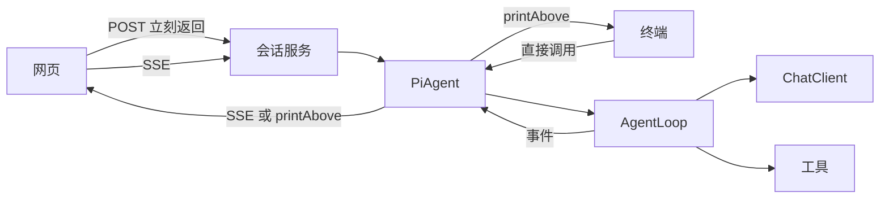
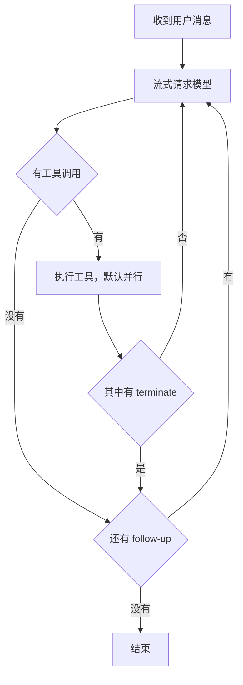
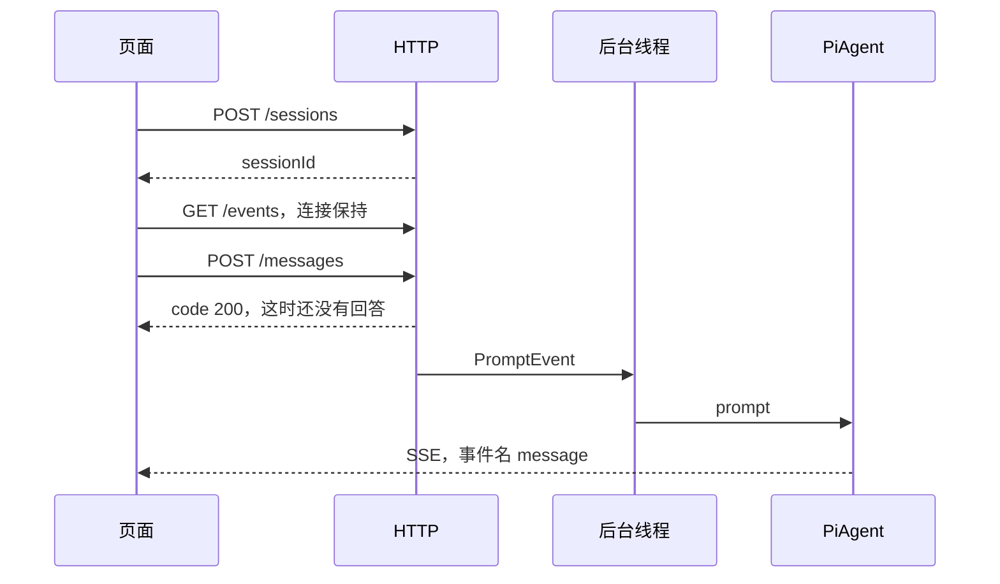
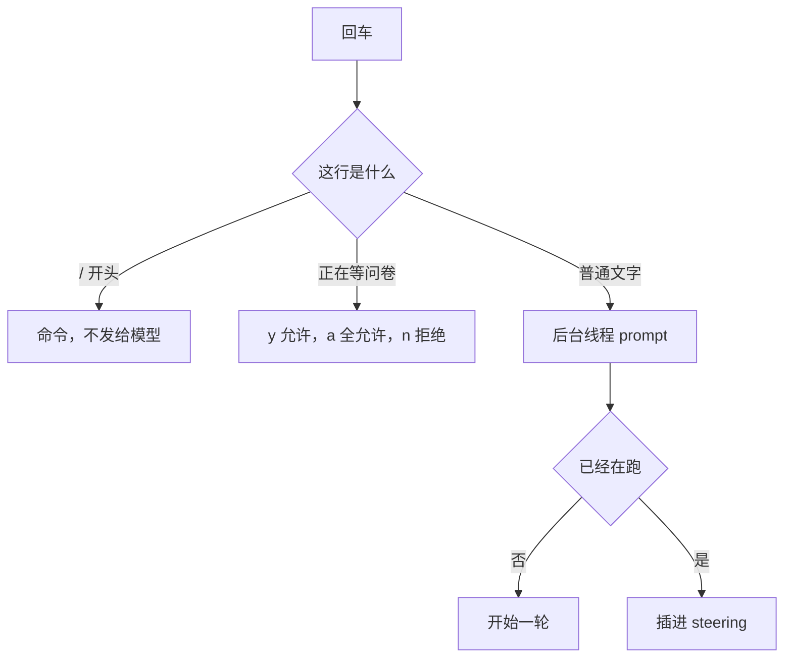

# Jotaro Agent
用java重写pi agent

一个用 Spring AI 写的编程 Agent。网页和终端是两种入口，背后是同一个循环：模型回复一次，循环执行它点名的工具，再把结果送回去，直到它不再要工具。

需要 Java 17 和 Maven。密钥放环境变量，不要写进仓库。

```bash
export DEEPSEEK_API_KEY=你的密钥
# 可选
# export ZHIPU_API_KEY=你的密钥
# export DASHSCOPE_API_KEY=你的密钥

mvn spring-boot:run
```

打开 http://127.0.0.1:8080 。页面由这个进程直接提供。

终端不监听端口，同一次启动不能又开网页：

```bash
mvn spring-boot:run -Dspring-boot.run.arguments=--tui
```

## 结构



网页把消息丢进后台线程，回答从 SSE 推回来。终端的读行留在主线程，`prompt` 跑在另一条线程上，所以运行中还能继续打字。会话存在内存里，进程退出就没了。

建议从 `src/main/java/org/jotaro/jotarocode/package-info.java` 读起，然后看 `agent/runtime/AgentLoop.java`。每个包的 `package-info.java` 说明它在这条链路里的位置。

## 一轮循环

一轮等于一次模型响应，加上它发起的全部工具调用。`max-steps` 数的是助手消息条数，默认 20。`message-window` 是发给模型的最近消息数，默认 40，更早的内容仍留在会话里，系统提示会保留。

Spring AI 的自动执行是关掉的。工具定义会发给模型，真正调用留在 `AgentLoop`，这样才有中止、并行和 `terminate`。



运行中再来的普通消息进入 steering，当前轮工具结束后插入。follow-up 要等到循环快停才插入。两条队列每次只取最早的一条。名叫 `terminate` 的工具会结束继续向模型要下一轮。

## 网页

打开页面时先拉模型和技能，创建会话，然后立刻用 `EventSource` 订阅 `/api/sessions/{id}/events`。必须先连上，否则开头的事件没有接收方。



用户气泡是本地先画的。`MESSAGE_UPDATE` 的 `text` 是增量，拼到当前助手气泡上。如果已经拼过增量，就不要再追加 `MESSAGE_END` 里的全文。运行中按钮变成「停止」，再点是中止，不会把第二句话插进当前轮。

## 终端

空闲提示符是 `◆ jotaro ❯`，运行中变成 `◆ steer ❯`，模型名在行尾。提示符在每次 `readLine` 开始时决定，这一行打字期间不会中途改掉。



普通文字用上下键翻已发送的内容。输入 `/` 后，上下键在候选里移动，回车选定；`/model` 选定后先补上空格，再选模型名。Tab 按前缀列出命令。灰色提示用右方向键或 Ctrl+E 接受。Ctrl+C 中断当前运行，Ctrl+D 退出。

`bash`、`powershell`、`write`、`edit` 执行前会问一句。`y` 允许这次，`a` 本次会话全部允许，`n` 拒绝，其他文字当作提示交回模型、不执行。`read`、`ls`、`grep`、`find` 直接执行。

命令：`/help`、`/abort`、`/reset`、`/model`、`/model 名称`、`/exit`、`/quit`。

## 工具

实现 `ToolContributor` 并标成 `@Component`，方法上用 `@Tool` 声明参数。Spring 会把这些 Bean 注入工厂，新工具不用改装配代码。

| 名称 | 作用 |
| --- | --- |
| `read` | 读文件。默认最多 2000 行或 50KB，可用 `offset`、`limit` 续读 |
| `write` | 创建或整文件覆盖。终端里执行前要确认 |
| `edit` | 精确替换。`oldText` 必须和原文一致、唯一，且多段互不重叠。终端里执行前要确认 |
| `bash` | 在当前工作目录执行命令，默认超时 120 秒。终端里执行前要确认 |
| `powershell` | 执行 PowerShell，优先 `pwsh`。终端里执行前要确认 |
| `ls` | 列目录，默认最多 500 条 |
| `grep` | 搜文件内容，默认最多 100 条 |
| `find` | 按 glob 找文件，默认最多 1000 条 |
| `currentTime` | 当前本地时间 |
| `terminate` | 结束这一轮循环 |

相对路径相对启动时的工作目录。`~` 会展开。`ls`、`grep`、`find` 遵守 `.gitignore`。`write` 和 `edit` 对同一文件串行。

## 技能

`SKILL.md` 可以放在这些目录：

- 项目内 `.agents/skills/` 或 `.pi/skills/`，从工作目录向上直到含 `.git` 的仓库根
- 用户目录 `~/.agents/skills/` 或 `~/.pi/agent/skills/`

```markdown
---
name: pdf-tools
description: 从 PDF 提取文字。阅读或转换 PDF 时使用。
---

# PDF

先读 references/formats.md。
```

系统提示里只有名称、描述和路径。模型认为匹配时用 `read` 打开文件。页面的技能下拉框，或输入 `/skill:pdf-tools 后面跟要求`，会把正文放进这条消息。`disable-model-invocation: true` 的技能只出现在下拉里。改技能后需要新开进程，已经创建的会话不会重新扫描。

## HTTP

成功和业务错误都是 HTTP 200。看 JSON 里的 `code`：`200` 成功，`500` 失败。

| 方法 | 路径 | 作用 |
| --- | --- | --- |
| `POST` | `/api/sessions` | 创建会话。正文可带 `model`、`systemPrompt` |
| `GET` | `/api/models` | 模型列表和默认模型 |
| `GET` | `/api/skills` | 技能名称、描述、是否仅命令可用 |
| `GET` | `/api/sessions/{id}/events` | SSE。事件名 `message`，正文是 JSON |
| `POST` | `/api/sessions/{id}/messages` | `{ "content": "..." }`。先连上 SSE 再发 |
| `POST` | `/api/sessions/{id}/queue` | `{ "content": "...", "kind": "STEER" }` 或 `FOLLOW_UP` |
| `POST` | `/api/sessions/{id}/abort` | 取消当前运行 |
| `POST` | `/api/sessions/{id}/reset` | 清空会话。运行中会拒绝 |
| `POST` | `/api/sessions/{id}/model` | `{ "model": "glm-4.6" }`。运行中会拒绝 |

内置模型名是 Bean 名：`deepseek-chat`、`glm-4.6`、`qwen4-max-preview`。`AGENT_END` 且 `stepLimitReached` 为真时，是助手消息到了步数上限。

## 配置

`piagent` 在 `application-local.yaml`，缺省值在 `PiAgentProperties`。

| 项 | 默认 | 含义 |
| --- | --- | --- |
| `mode` | `server` | `server` 提供网页，`tui` 只开终端 |
| `model` | `deepseek-chat` | 新会话的默认模型 |
| `max-steps` | `20` | 一次运行最多多少条助手消息 |
| `message-window` | `40` | 发给模型的最近消息数 |
| `system-prompt` | 见文件 | 工具使用说明。技能目录接在它后面 |

## 测试

```bash
mvn test
```

循环、工具、技能发现和终端输出都不访问真实模型。
