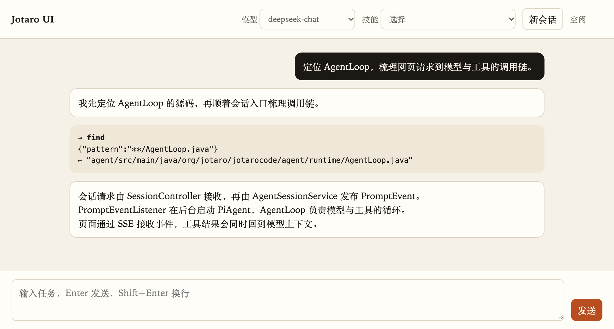
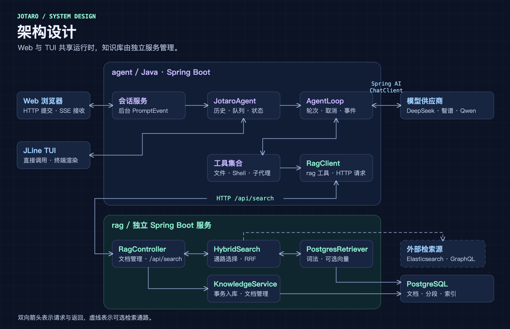
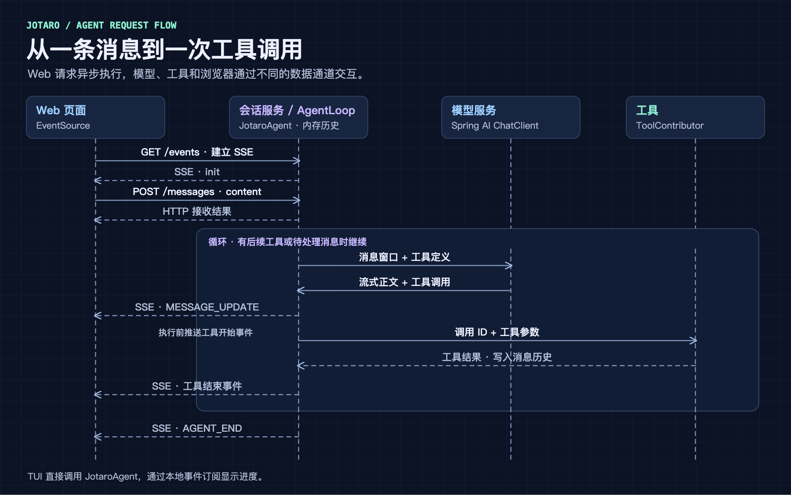
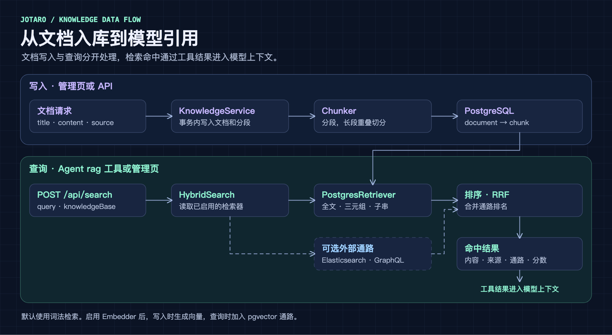

<p align="center">
  
</p>

# Jotaro Agent

**在终端里边跑边改方向，在网页上看每一次工具调用。**

Jotaro 是用 Java 和 Spring AI 实现的 Pi 风格编程助手。它能读写仓库、执行命令、联网搜索、拆任务给子代理，也能把你录入的项目资料通过混合检索带进模型上下文。

<div align="center">


[快速开始](#快速开始) · [一键打包与启动](#一键打包与启动) · [终端体验](#终端体验) · [上下文管理](#上下文管理) · [工具和扩展](#工具和扩展) · [知识库](#知识库) · [架构设计](#架构设计) · [HTTP API](#http-api)

</div>

## 看它跑一遍

> 定位 `AgentLoop`，梳理网页请求到模型与工具的调用链。



*网页实拍。演示使用本地模拟模型，`find` 的命中来自当前仓库。*

想缩小调查范围？在 TUI 正在运行时直接输入「只追 SSE 推送」，新指令会在本轮工具结束后作为 `STEER` 进入模型上下文。任务适合拆开时，可以用只读子代理 `explore` 分头找入口；需要实时外部资料时调用 `webSearch` 联网检索；要查仓库外的团队内部资料，则让 `rag` 工具检索知识库片段。

## 快速开始

需要 **JDK 17+** 和 **Maven**。你只需配置实际使用的模型供应商密钥，**未配置 API Key 的厂家会自动忽略并从模型列表中隐藏，不会导致启动报错**。

```bash
export SPRING_AI_DEEPSEEK_API_KEY="你的_DeepSeek_Key"
mvn -pl agent spring-boot:run
```

打开 [Agent 网页](http://127.0.0.1:8080)，可以试一句：

> 先列出这个仓库的模块，找到模型与工具循环的入口。只读文件，最后给我一条带文件路径的阅读路线。

仓库包含两个可独立运行的应用：

| 应用 | 默认入口 | 负责什么 |
| --- | --- | --- |
| `agent` | 终端 TUI 或 [127.0.0.1:8080](http://127.0.0.1:8080) | 会话、模型调用、工具调度、流式事件、联网搜索 |
| `rag` | [127.0.0.1:8090](http://127.0.0.1:8090) | 知识库管理、文档切分入库、多路混合检索 |

### 模型配置与按需启用

模型名称来自 [MultiChatClientConfig](agent/src/main/java/org/jotaro/jotarocode/config/MultiChatClientConfig.java)，由 [ProviderApiKeys](agent/src/main/java/org/jotaro/jotarocode/config/ProviderApiKeys.java) 和 [ChatClientRegistry](agent/src/main/java/org/jotaro/jotarocode/config/ChatClientRegistry.java) 自动检测各厂家的 API Key。可在网页下拉框或终端 `/model` 中随时切换：

| 会话模型名 | 供应商 | 密钥环境变量 / 配置项 | 说明 |
| --- | --- | --- | --- |
| `deepseek-chat` | DeepSeek | `SPRING_AI_DEEPSEEK_API_KEY` | 默认模型；若未配该 Key 会自动回退到首个已配置的模型 |
| `glm-4.6` | 智谱 BigModel | `SPRING_AI_ZHIPUAI_API_KEY` | 配置后同时自动启用内置 `webSearch` 联网搜索工具 |
| `qwen4-max-preview` | DashScope OpenAI 兼容接口 | `SPRING_AI_OPENAI_API_KEY` | 阿里云百炼 OpenAI 兼容模式 |

也可把配置放在本地的 `agent/src/main/resources/application-local.yaml`（已被 `.gitignore` 忽略，`application.yaml` 默认激活 `local` profile）。哪个厂家不配 Key，留空或直接删掉对应配置块即可。

## 一键打包与启动

仓库根目录提供了打包与全局启动命令安装脚本 [package-agent.sh](package-agent.sh)：

```bash
./package-agent.sh
```

执行后会完成三件事：
1. 打包 `agent/target/jotaro-agent-0.0.1-SNAPSHOT.jar` 并同步到 `~/.jotaro/bin/jotaro-agent.jar`。
2. 将相对路径解析的启动脚本 [bin/start-jotaro.sh](bin/start-jotaro.sh) 软链至 `~/.jotaro/bin/start-jotaro`。
3. 在 `~/.zshrc` 中注册 `start jotaro` 命令（当前终端执行一次 `source ~/.zshrc` 即可生效）。

之后你可以在**任意项目目录**下直接启动 Jotaro（当前所在目录即 Agent 读写文件与执行命令的工作目录）：

```bash
start jotaro         # 默认进入 TUI 终端交互模式（--tui）
start jotaro --web   # 启动 Web 网页服务模式（http://127.0.0.1:8080）
```

### 交给别人单独运行

别人只跑 Agent 时，把 `agent/target/jotaro-agent-0.0.1-SNAPSHOT.jar` 发给对方即可（仅需 **JDK 17+**）：

```bash
export SPRING_AI_DEEPSEEK_API_KEY=对方自己的密钥

java -jar /路径/jotaro-agent-0.0.1-SNAPSHOT.jar --tui   # 终端模式
java -jar /路径/jotaro-agent-0.0.1-SNAPSHOT.jar         # 网页模式（127.0.0.1:8080）
```

> 打包分发前请确认 `agent/src/main/resources/application-local.yaml` 中未写入私人密钥，因为资源目录下的文件会一并打入 jar 包。

## 终端体验

<pre>
● explore
  → find  查找 AgentLoop
  → read  阅读循环与事件出口
  ⎿ 完成

╭─ steer ────────────────────────────────────────
│ 先只梳理工具执行和取消逻辑
╰─ deepseek-chat · 继续输入会插入这一轮 · ctrl-c 停止 ──
</pre>

空闲时输入框左上角显示 `jotaro`，运行时自动切为 `steer`。运行中直接输入普通文本，会在当前工具批次结束后作为 steering 插入本轮对话。

### 列式候选菜单与快捷键

输入 `/` 或 `/model` 时，终端会展开单列候选菜单，**自动以绿色实心圆 `●` 选中默认项或当前正在使用的模型**：

<pre>
╭─ jotaro ───────────────────────────────────────
❯ /model deepseek-chat
● deepseek-chat
  glm-4.6
  qwen4-max-preview
</pre>

| 操作 | 用法 |
| --- | --- |
| 斜杠命令选择 | 输入 `/` 自动高亮选中首项 `● /help`，上下方向键切换，回车确认，Esc 或 Ctrl+C 收起并恢复原输入 |
| 模型切换 | 输入 `/model` 回车，自动定位并选中当前模型（`● <当前模型>`），上下键切换其他已配置模型，回车立即切换 |
| 上下文管理命令 | `/context` 查看 Token 水位、Redis/SQLite 存储与裁剪/压缩统计；`/goal <目标>` 锚定长任务目标；`/compact [比例]` 手动触发子代理压缩（默认 70%）；`/resume [序号\|会话ID]` 从 SQLite 恢复历史会话上下文 |
| 停止、重置、退出 | `/abort` 中止当前运行、`/new` 开启新会话并保留旧会话（可用 `/resume` 恢复）、`/reset` 清空当前会话与事件日志、`/exit` 或 `/quit`（或 Ctrl+D / Ctrl+Z）退出 |
| 历史与补全 | 普通文本按上下方向键回溯历史消息；Tab 触发补全，右方向键或 Ctrl+E 接受灰色内联建议 |
| 粘贴文本与图片 | 粘贴超过 5 行或 800 字自动收折为 `[Pasted text #1 +N lines]`，发送时展开全文；Ctrl+V 支持直接从剪贴板粘贴图片 |

终端在执行写操作或命令工具（`bash`、`powershell`、`write`、`edit` 及 MCP 工具）前会弹出确认框：输入 `y` 允许本次，`a` 本次会话全部允许，`n` 拒绝；输入其他文字会阻止本次调用并将文字作为提示反馈给模型。

## 上下文管理

参考 **DeepSeek Harness** 的上下文架构，Jotaro 将「**不可变事件日志（Event Log）**」与「**发往模型的动态派生视图（`ContextPipeline`）**」彻底分离：

1. **Redis 不可变事件日志**（[RedisContextStore](agent/src/main/java/org/jotaro/jotarocode/agent/context/RedisContextStore.java)）：
   - 默认连接本地 Redis（`127.0.0.1:6379`），按 `jotaro:ctx:<sessionId>:events` 将每条系统提示、用户消息、助手回复、工具结果、任务目标与压缩检查点以不可变 JSON 事件追加写入（默认 TTL 24 小时）。
   - 若本地未启动 Redis，会自动无感降级为进程内存存储，不影响正常使用。
2. **动态派生与旧工具输出裁剪**（[ContextPipeline](agent/src/main/java/org/jotaro/jotarocode/agent/context/ContextPipeline.java)）：
   - 每次请求模型前从最新 `COMPACTION` 检查点回放活跃事件，并将 `/goal` 设置的核心任务目标自动锚定在 `SystemMessage` 末尾。
   - **Tool Result Pruner**：完整保留最近 4 轮工具输出，对更早轮次超过 800 字符的超大工具输出在模型视图中折叠为占位提示（Redis 原始日志保持完整不丢失）。
3. **0.8 模型水位自动子代理压缩**（[ContextCompactor](agent/src/main/java/org/jotaro/jotarocode/agent/runtime/ContextCompactor.java)）：
   - 自动根据当前选中模型支持的最大上下文窗口（如 `deepseek-chat` 64K、`glm-4.6` / `qwen4-max-preview` 128K）估算当前上下文 Token 数。
   - 当达到所选模型最大上下文的 **0.8（80%）** 时，自动派生无工具的 `compact` 子代理将前 **70%**（`jotaro.compact-ratio` 可配置）的历史消息浓缩成结构化摘要，向 Redis 追加 `COMPACTION` 检查点并保留最近 30% 的原始消息（严格保护 `ToolCall` / `ToolResponse` 成对不断裂）。
4. **实时上下文洞察**：在 TUI 输入 `/context` 或调用 `GET /api/sessions/{id}/context` 可随时查看存储后端、Token 水位百分比、裁剪次数、压缩次数与当前任务目标。

## 工具和扩展

| 工具 | 用途 |
| --- | --- |
| `read`、`ls`、`grep`、`find` | 读文件（支持文本与图片）、列目录、正则搜内容、按 glob 找文件。后三项自动遵守 `.gitignore` |
| `write`、`edit` | 整文件创建/覆盖、精确替换。同一文件的并发变更通过锁串行化，每段 `oldText` 需唯一且互不重叠 |
| `bash`、`powershell` | 在当前工作目录执行命令。默认超时 120 秒，PowerShell 优先使用 `pwsh` |
| `sqlite` | 内嵌 SQLite 数据库工具（默认库位于当前工作区 `.jotaro/jotaro.db`），支持建表、增删改查及 `.tables` / `.schema` 元信息查看 |
| `webSearch` | 调用智谱 Web Search 接口检索实时网页、技术文档与外部资讯，支持条数 `count` 和域名过滤 `domain` |
| `subagent` | 委派独立子任务（支持单任务、并行 `tasks`、链式 `chain`） |
| `rag` | 从独立知识库服务检索文档片段（配置了 `jotaro.rag.bases` 时启用） |
| `currentTime`、`terminate` | 获取当前本地时间、显式结束当前轮工具循环 |
| MCP 工具 | 启动时连接 `spring.ai.mcp.client` 下配置的 MCP 服务，工具名自动加上服务名前缀 |

- **大文件分页读取**：`read` 默认单次最多返回 2,000 行或 50 KB，超出时提示剩余行数，模型可通过 `offset` 和 `limit` 分段续读。
- **联网搜索（`webSearch`）**：默认复用 `spring.ai.zhipuai.api-key`，也可在 `jotaro.web-search.api-key` 中单独配置。未配置有效密钥时自动隐藏该工具。
- **自定义新工具**：实现 [ToolContributor](agent/src/main/java/org/jotaro/jotarocode/agent/tools/ToolContributor.java) 接口并加上 `@Component` 和 `@Tool`，Spring 会自动收集注入，无需修改工厂代码。
- **连接 MCP 服务**：在 `spring.ai.mcp.client` 下支持 `stdio`、`sse` 和 `streamable-http`：

```yaml
spring:
  ai:
    mcp:
      client:
        stdio:
          connections:
            filesystem:
              command: npx
              args:
                - -y
                - "@modelcontextprotocol/server-filesystem"
                - .
```

## 子代理和技能

### 子代理（`subagent`）

`subagent` 工具支持三种调度模式：

| 参数 | 执行方式 |
| --- | --- |
| `agent` + `task` | 单独运行一个子代理 |
| `tasks` | 并行处理互不依赖的一批任务（最多 8 项，单批最多 4 项并发） |
| `chain` | 按顺序链式执行，后续步骤可在 `task` 中用 `{previous}` 引用上一步结果 |

- 内置 `explore`（只读，仅含 `read`、`grep`、`find`、`ls`）与 `general`（可使用除 `subagent` 外的全部工具）。
- 子代理拥有独立上下文窗口，默认继承父代理当前模型，最多运行 8 轮。
- 可在 `~/.jotaro/agents/` 或项目 `.jotaro/agents/` 下用 Markdown frontmatter（`name`、`description`、`tools`、`model`）新增或覆盖子代理定义。

### 技能（Skills）

技能存放在 `~/.jotaro/skills/`、`~/.agents/skills/`，或项目内向上到仓库根的 `.jotaro/skills/`、`.agents/skills/` 下：

```markdown
---
name: review-changes
description: 按项目约定检查变更。用户要求审阅代码时使用。
---

先读 references/review-guide.md，再检查改动涉及的调用链。
```

模型会根据系统提示中的技能目录按需调用 `read` 读取对应的 `SKILL.md`；网页端也可从下拉框选择技能，或在消息开头输入 `/skill:review-changes 检查本次改动` 强制展开。设置 `disable-model-invocation: true` 可限制该技能仅通过 `/skill:名称` 显式触发。

## 知识库

RAG 服务需要 PostgreSQL 以及 **pgvector** 和 **pg_trgm** 扩展。启动时自动执行 [schema.sql](rag/src/main/resources/schema.sql) 初始化表、扩展和索引：

```bash
createdb -h 127.0.0.1 -p 5432 jotaro_rag
mvn -pl rag spring-boot:run -Dspring-boot.run.skip=false
```

默认连接 `jdbc:postgresql://127.0.0.1:5432/jotaro_rag`，可通过 `SPRING_DATASOURCE_URL`、`SPRING_DATASOURCE_USERNAME`、`RAG_DB_PASSWORD` 覆盖。

打开 [知识库管理页](http://127.0.0.1:8090)，可建库、按字数或自定义分隔符分段入库、查看原文与切片，并在检索验证里查看最终 Top N 与各阶段召回得分。也可直接通过 HTTP API 调用：

```bash
curl -fsS http://127.0.0.1:8090/api/bases \
  -H 'Content-Type: application/json' \
  -d '{"name":"project-notes","description":"项目开发笔记"}'

curl -fsS http://127.0.0.1:8090/api/bases/project-notes/documents \
  -H 'Content-Type: application/json' \
  -d '{"title":"会话事件","source":"docs/events.md","content":"网页先建立 SSE 连接，再提交用户消息。"}'

curl -fsS http://127.0.0.1:8090/api/search \
  -H 'Content-Type: application/json' \
  -d '{"query":"SSE","knowledgeBase":"project-notes","limit":3}'
```

Agent 侧通过 `jotaro.rag.base-url` 和 `jotaro.rag.bases` 控制知识库访问：不配 `bases` 时隐藏 `rag` 工具；`name: ALL` 允许跨库查全部；只配一个具体库时默认查该库；配了多个具体库时模型必须显式指定 `knowledgeBase`。

## 架构设计



| 组件 | 负责什么 |
| --- | --- |
| [会话服务](agent/src/main/java/org/jotaro/jotarocode/service/impl/AgentSessionServiceImpl.java) | Web 会话通过 HTTP 接收消息，发布异步 `PromptEvent`，将运行事件转换为 SSE 推送 |
| [JotaroAgent](agent/src/main/java/org/jotaro/jotarocode/agent/JotaroAgent.java) | 维护会话历史、运行状态、steering 和 follow-up 队列。Web 会话与 TUI 各自持有独立实例 |
| [AgentLoop](agent/src/main/java/org/jotaro/jotarocode/agent/runtime/AgentLoop.java) | 裁剪消息窗口、并行/串行调度工具、处理中断与步数上限，流式聚合模型响应 |
| [知识库服务](rag/src/main/java/org/jotaro/rag/web/RagController.java) | 独立进程运行，提供文档切片入库与多路混合检索（PostgreSQL 全文/三元组/向量 + 可选 ES/GraphQL + RRF 融合） |

## 数据流转

### Agent 消息与工具结果



1. **收消息**：Web 创建会话并订阅 SSE，收到 `init` 后提交消息；TUI 直接在本地事件循环中提交。
2. **请求模型**：每轮发送最近消息窗口与已启用工具定义。窗口始终保留系统提示，并避免截断成对的工具调用与结果。模型增量转为 `MESSAGE_UPDATE` 实时渲染。
3. **执行工具**：流式响应聚合完成后执行工具调用。默认并行执行，并通过 `toolCallId` 关联开始与结束事件。
4. **进入下一轮或收尾**：轮次之间优先消费 `STEER` 队列，循环即将结束时消费 `FOLLOW_UP` 队列。结束时发出 `AGENT_END`（达到步数上限时带 `stepLimitReached`）。

### RAG 文档与检索结果



- **入库**：支持按字数（默认 700 字、重叠 80 字）或自定义分隔符切分，短段落自动合并，超长段落二次切分。
- **检索**：PostgreSQL 通路结合全文检索、`pg_trgm` 三元组相似度和子串匹配，可选开启 `vector(1024)` 向量检索、Elasticsearch 与 GraphQL 通路，最终通过 RRF（Reciprocal Rank Fusion）融合排序。
- **回流**：[RagClient](agent/src/main/java/org/jotaro/jotarocode/agent/rag/RagClient.java) 将命中的标题、正文、通路和得分格式化为文本结果返回给模型。

## HTTP API

### Agent（默认 `8080`）

| 方法与路径 | 请求或响应 |
| --- | --- |
| `GET /api/models` | 已配置可用的模型列表与默认模型 |
| `GET /api/skills` | 已发现技能及其触发方式 |
| `POST /api/sessions` | 可传 `model`、`systemPrompt`，返回 `sessionId` |
| `GET /api/sessions/{id}/events` | SSE 事件流订阅 |
| `POST /api/sessions/{id}/messages` | 提交消息 `{"content":"..."}` |
| `POST /api/sessions/{id}/queue` | 运行中追加消息 `{"content":"...","kind":"STEER"}`（或 `FOLLOW_UP`） |
| `POST /api/sessions/{id}/abort` | 中止当前运行 |
| `POST /api/sessions/{id}/reset` | 清空会话历史与事件日志（需处于空闲状态） |
| `POST /api/sessions/{id}/model` | 切换模型 `{"model":"glm-4.6"}`（需处于空闲状态） |
| `GET /api/sessions/{id}/context` | 获取上下文洞察快照（存储介质、Token 水位、裁剪与压缩统计、目标锚点） |
| `POST /api/sessions/{id}/compact` | 手动触发子代理压缩（可选查询参数 `?ratio=0.7`） |

### RAG（默认 `8090`）

| 方法与路径 | 请求或响应 |
| --- | --- |
| `GET /api/routes` | 各检索通路及启用状态 |
| `GET /api/bases` / `POST /api/bases` | 列出知识库 / 按 `name` 和可选 `description` 创建知识库 |
| `GET /api/bases/{name}/documents` / `POST /api/bases/{name}/documents` | 列文档 / 写入 `title`、`content` 和可选 `source` |
| `DELETE /api/documents/{id}` | 删除文档及所属分段 |
| `POST /api/search` | 传 `query`、可选 `knowledgeBase` 和 `limit`（1~20，默认 5），返回 `hits` |
| `POST /api/search/explain` | 返回各通路召回明细与 RRF 融合过程 |

## 开发与测试

| 模块/目录 | 代码入口 |
| --- | --- |
| 模型调用、工具调度、事件循环与子代理压缩 | [agent/runtime](agent/src/main/java/org/jotaro/jotarocode/agent/runtime) |
| 上下文管理（Redis 事件日志 + 动态派生） | [agent/context](agent/src/main/java/org/jotaro/jotarocode/agent/context) |
| 文件与命令工具 | [agent/tools/coding](agent/src/main/java/org/jotaro/jotarocode/agent/tools/coding) |
| 内嵌 SQLite 客户端与工具 | [agent/sqlite](agent/src/main/java/org/jotaro/jotarocode/agent/sqlite)、[SqliteTool](agent/src/main/java/org/jotaro/jotarocode/agent/tools/SqliteTool.java) |
| 联网搜索客户端与工具 | [agent/search](agent/src/main/java/org/jotaro/jotarocode/agent/search)、[WebSearchTool](agent/src/main/java/org/jotaro/jotarocode/agent/tools/WebSearchTool.java) |
| 供应商密钥检测与模型注册表 | [ProviderApiKeys](agent/src/main/java/org/jotaro/jotarocode/config/ProviderApiKeys.java)、[ChatClientRegistry](agent/src/main/java/org/jotaro/jotarocode/config/ChatClientRegistry.java) |
| 终端 TUI 交互与行读取器 | [tui](agent/src/main/java/org/jotaro/jotarocode/tui) |
| 知识库切分、索引和混合检索 | [rag/index](rag/src/main/java/org/jotaro/rag/index)、[rag/retrieval](rag/src/main/java/org/jotaro/rag/retrieval) |
| Web 前端页面 | [Agent 网页](agent/src/main/resources/static/index.html)、[知识库网页](rag/src/main/resources/static/index.html) |

```bash
./package-agent.sh                                               # 打包 Agent 并更新 start jotaro 命令
mvn -pl agent test                                               # 运行 Agent 全部单元测试（无需真实模型或数据库）
mvn -pl rag -Dtest=ChunkerTest,RrfTest,RetrieverParseTest test   # 运行 RAG 纯单元测试
mvn test                                                         # 运行全量测试（含 PostgreSQL 集成测试）
```

### 核心配置项

常用 Agent 配置定义在 [JotaroAgentProperties](agent/src/main/java/org/jotaro/jotarocode/config/JotaroAgentProperties.java)，RAG 配置见 [rag/application.yaml](rag/src/main/resources/application.yaml)：

| 配置项 | 默认值 | 含义 |
| --- | --- | --- |
| `jotaro.mode` | `server` | 运行模式：`server`（Web 网页）或 `tui`（终端交互，`--tui` 会自动覆盖为 `tui`） |
| `jotaro.model` | `deepseek-chat` | 默认模型；若对应厂家未配 Key 会自动回退到首个可用模型 |
| `jotaro.max-steps` | `20` | 单次运行允许的最大助手消息轮数 |
| `jotaro.compact-threshold` | `0.8` | 触发自动上下文压缩的 Token 水位比例（达到所选模型最大上下文的 80% 时触发） |
| `jotaro.compact-ratio` | `0.7` | 触发压缩时由 `compact` 子代理浓缩的历史消息比例（默认 70%，支持写 `0.7` 或 `70`） |
| `jotaro.model-context-limits` | 见配置 | 各模型支持的最大上下文 Token 数（如 `deepseek-chat: 64000`、`glm-4.6: 128000`） |
| `jotaro.context.redis-enabled` | `true` | 是否启用本地 Redis 持久化上下文事件日志（Redis 不可用时自动降级为内存） |
| `jotaro.context.keep-recent-tool-turns` | `4` | 动态派生上下文时完整保留最近多少轮工具输出，更早轮次超大输出自动裁剪 |
| `jotaro.context.tool-prune-chars` | `800` | 较早轮次单条工具输出超过该字符数时在派生视图中折叠裁剪 |
| `jotaro.sqlite.path` | `.jotaro/jotaro.db` | 内嵌 SQLite 默认数据库路径（相对当前工作目录，首次调用自动创建） |
| `jotaro.sqlite.max-rows` | `200` | 单次 SQLite `SELECT` 查询最多返回的行数上限 |
| `jotaro.web-search.url` | `https://open.bigmodel.cn/api/paas/v4/web_search` | 智谱联网搜索接口地址 |
| `jotaro.web-search.api-key` | 空（自动复用 `spring.ai.zhipuai.api-key`） | 联网搜索密钥；均未配置时自动隐藏 `webSearch` 工具 |
| `jotaro.web-search.engine` | `search_std` | 搜索引擎类型（如 `search_std`、`search_pro`） |
| `jotaro.web-search.count` | `5` | `webSearch` 默认返回结果条数 |
| `jotaro.rag.base-url` | `http://127.0.0.1:8090` | 知识库服务 HTTP 地址 |
| `jotaro.rag.bases` | 空 | 允许查询的知识库列表（空列表不启用 `rag`，`name: ALL` 可查全部） |
| `rag.rrf-k` | `60` | 混合检索倒数排名融合（RRF）常数 |
