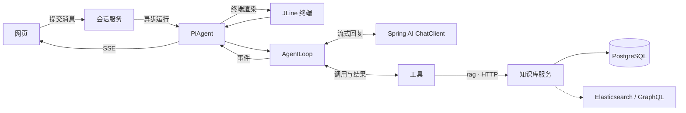

<div align="center">

# ⚡ Jotaro Agent

**用 Java 和 Spring AI 实现的 Pi 风格编程助手**

在终端边跑边调整任务，在网页实时看模型与工具的输出，也能从自己的知识库检索项目资料。


[快速开始](#快速开始) · [终端体验](#终端体验) · [知识库](#知识库) · [架构](#架构) · [HTTP API](#http-api) · [开发与测试](#开发与测试)

</div>

## 你可以用它做什么

- **读懂一个陌生仓库**。让 Agent 搜索入口、读关键文件，并按路径给出一条可追踪的调用链。
- **在执行过程中改变方向**。在终端补一句「先只看检索模块」，当前工具批次结束后，指令就会进入下一次模型请求。
- **把独立任务交给子代理**。让 `explore` 只读调查，或用 `general` 处理需要工具执行的任务。终端会把子代理的活动显示在对应任务下。
- **带着团队资料写代码**。把架构笔记、操作手册或接口说明录入知识库，再让 Agent 用 `rag` 检索相关片段和来源。

## 快速开始

需要 **JDK 17+** 和 **Maven**。先在仓库根目录配置默认模型。以下命令为 Bash / Zsh 写法。

```bash
read -rs 'DEEPSEEK_API_KEY?DeepSeek API key: '  # Zsh
export DEEPSEEK_API_KEY
export SPRING_AI_DEEPSEEK_API_KEY="$DEEPSEEK_API_KEY"

# Spring 启动时同时装配三个供应商。只使用 DeepSeek 时，另外两个可先用占位值。
export SPRING_AI_ZHIPUAI_API_KEY="${ZHIPU_API_KEY:-unused}"
export SPRING_AI_OPENAI_API_KEY="${DASHSCOPE_API_KEY:-unused}"

mvn -pl agent spring-boot:run
```

在 Bash 中，用 `read -rsp 'DeepSeek API key: ' DEEPSEEK_API_KEY` 输入密钥。打开 [Agent 网页](http://127.0.0.1:8080)，可以试一句：

> 先列出这个仓库的模块，找到模型与工具循环的入口。只读文件，最后给我一条带文件路径的阅读路线。

两个应用可以独立运行：

| 应用 | 默认入口 | 负责什么 |
| --- | --- | --- |
| `agent` | [127.0.0.1:8080](http://127.0.0.1:8080) 或终端 | 会话、模型调用、工具调度、流式事件 |
| `rag` | [127.0.0.1:8090](http://127.0.0.1:8090) | 知识库管理、文档入库、混合检索 |

### 模型切换

模型名称来自 [ChatClient Bean](agent/src/main/java/org/jotaro/jotarocode/config/MultiChatClientConfig.java)。可在网页下拉框或终端 `/model` 中切换。

| 会话模型名 | 供应商 | 密钥环境变量 |
| --- | --- | --- |
| `deepseek-chat` | DeepSeek | `SPRING_AI_DEEPSEEK_API_KEY` |
| `glm-4.6` | 智谱 | `SPRING_AI_ZHIPUAI_API_KEY` |
| `qwen4-max-preview` | DashScope OpenAI 兼容接口 | `SPRING_AI_OPENAI_API_KEY` |

使用表中的供应商时，将对应变量设为有效密钥。使用 Qwen 时还需将 OpenAI 兼容客户端指向账号对应的 DashScope 端点，并配置模型，例如：

```bash
export SPRING_AI_OPENAI_BASE_URL=https://token-plan.cn-beijing.maas.aliyuncs.com/compatible-mode
export SPRING_AI_OPENAI_CHAT_OPTIONS_MODEL=qwen4-max-preview
```

也可把配置放在本地的 `agent/src/main/resources/application-local.yaml`。仓库忽略这个文件，`application.yaml` 会激活 `local` profile。环境变量适用于全新克隆。

### 打包和启动

```bash
mvn -DskipTests package
java -jar agent/target/jotaro-agent-0.0.1-SNAPSHOT.jar        # 网页
java -jar agent/target/jotaro-agent-0.0.1-SNAPSHOT.jar --tui  # 终端，单独启动
java -jar rag/target/jotaro-rag-0.0.1-SNAPSHOT.jar             # 需要已就绪的数据库
```

以 `java -jar` 启动时，Agent 工具从当前工作目录解析相对路径。希望它读取其他项目时，先切到该项目目录，再用 jar 的绝对路径启动。TUI 使用独立进程且不监听 Web 端口。

## 终端体验

<pre>
● explore
  → find  查找 AgentLoop
  → read  阅读循环与事件出口
  ⎿ 完成

╭─ steer ────────────────────────────────────────
│ 先只梳理工具执行和取消逻辑
╰─ deepseek-chat ────────────────────────────────
</pre>

上面是界面示意。空闲时输入框显示 `jotaro`，运行时切为 `steer`。普通输入会在当前工具批次结束后插入。网页运行中的发送按钮用于停止，HTTP 客户端可通过队列接口追加消息。

| 操作 | 用法 |
| --- | --- |
| 列出命令 | `/help`，或键入 `/` 后用上下键选择 |
| 切换模型 | `/model` 或 `/model glm-4.6` |
| 停止、重置、退出 | `/abort`、`/reset`、`/exit` 或 `/quit` |
| 键盘操作 | Tab 补全，右方向键或 Ctrl+E 接受灰色建议，Ctrl+C 中断，Ctrl+D 退出 |
| 粘贴 | 超过 5 行或 800 字时显示摘要，提交时恢复原文。Ctrl+V 可从剪贴板粘贴图片，模型需要支持图片输入 |

终端在 `bash`、`powershell`、`write`、`edit` 前询问。输入 `y` 允许这次，`a` 允许本会话后续调用，`n` 拒绝。输入其他文字会阻止本次调用，并把文字作为反馈返回。

## 知识库

RAG 服务需要可连接的 PostgreSQL，以及可用于当前 PostgreSQL 版本的 **pgvector** 和 **pg_trgm** 扩展。启动时执行 [schema.sql](rag/src/main/resources/schema.sql)，初始化表、扩展和索引。以下示例使用当前系统用户名作为 PostgreSQL 角色，角色需要能创建库及初始化扩展。

```bash
createdb -h 127.0.0.1 -p 5432 jotaro_rag
mvn -pl rag spring-boot:run
```

默认连接 `jdbc:postgresql://127.0.0.1:5432/jotaro_rag`，密码由 `RAG_DB_PASSWORD` 提供。连接地址和用户可用 `SPRING_DATASOURCE_URL`、`SPRING_DATASOURCE_USERNAME` 覆盖。

打开 [知识库管理页](http://127.0.0.1:8090)，也可以直接用 API 完成一次「建库 → 入库 → 检索」：

```bash
curl -fsS http://127.0.0.1:8090/api/bases \
  -H 'Content-Type: application/json' \
  -d '{"name":"project-notes","description":"项目开发笔记"}'

curl -fsS http://127.0.0.1:8090/api/bases/project-notes/documents \
  -H 'Content-Type: application/json' \
  -d '{"title":"会话事件","source":"docs/events.md","content":"网页先建立 SSE 连接，再提交用户消息。"}'

curl -fsS http://127.0.0.1:8090/api/search \
  -H 'Content-Type: application/json' \
  -d '{"query":"SSE","knowledgeBase":"project-notes","limit":3}'
```

回到 Agent，输入「用 `rag` 查一下 `project-notes` 里 SSE 的连接顺序，并注明来源」。两套应用通过 HTTP 通信，Agent 侧的地址由 `piagent.rag.base-url` 控制。

默认 PostgreSQL 通路结合全文、三元组相似度和子串匹配。向量检索需要注册 `Embedder` 并开启 `rag.embedding.enabled`，输出维度需匹配 `vector(1024)`。Elasticsearch 和 GraphQL 检索器由各自的 `enabled` 开关启用，并读取各自的外部索引或接口。入库 API 写入 PostgreSQL。混合检索用 RRF 合并排名，片段标识按通路和 ID 组合。

## 架构



[PiAgent](agent/src/main/java/org/jotaro/jotarocode/agent/PiAgent.java) 保存会话历史和消息队列。[AgentLoop](agent/src/main/java/org/jotaro/jotarocode/agent/runtime/AgentLoop.java) 每轮发起一次流式模型请求，把工具结果放回历史再继续。Spring AI 负责模型适配，运行时负责执行工具、发事件和传播取消。

- 同一批工具默认并行。批次含要求顺序执行的工具时，整批改为顺序执行。结果按模型给出的调用顺序组装。
- `STEER` 在轮次之间检查，`FOLLOW_UP` 在循环即将结束时检查。两条队列每次各取一条。模型没有后续工具、调用 `terminate`、达到步数限制或被中止时，循环按相应条件收尾。
- 会话历史在进程内保存。模型只收到配置窗口内的最近消息，系统提示和窗口边界的工具调用配对会保留。

### 工具和扩展

| 工具 | 用途 |
| --- | --- |
| `read`、`ls`、`grep`、`find` | 读取、列目录、搜索内容、按 glob 找文件。后三项支持 `.gitignore` |
| `write`、`edit` | 整文件写入或精确替换。同一文件的变更串行，替换目标需唯一且互不重叠 |
| `bash`、`powershell` | 在工作目录执行命令。默认超时 120 秒，PowerShell 优先使用 `pwsh` |
| `currentTime`、`terminate` | 读取本地时间、结束工具驱动的继续调用 |
| `subagent`、`rag` | 委派任务、从独立知识库服务检索片段 |

`read` 默认最多返回 2,000 行或 50 KB，可用 `offset` 和 `limit` 续读。新增工具时，实现 [ToolContributor](agent/src/main/java/org/jotaro/jotarocode/agent/tools/ToolContributor.java)，注册为 Spring 组件，在方法上声明 `@Tool`。新增检索通路则实现 [Retriever](rag/src/main/java/org/jotaro/rag/retrieval/Retriever.java) 并注册组件。

### 子代理和技能

`subagent` 支持三种输入方式：

| 参数 | 执行方式 |
| --- | --- |
| `agent` + `task` | 运行一个子代理 |
| `tasks` | 并行处理独立任务，最多 8 项，单批最多 4 项同时运行 |
| `chain` | 顺序执行，后续任务可用 `{previous}` 引用上一步结果 |

内置 `explore` 仅有 `read`、`grep`、`find`、`ls`。内置 `general` 可以使用除 `subagent` 以外的工具。子代理有独立上下文，默认继承父会话的模型，最多运行 8 个模型轮次。可在 `~/.pi/agent/agents/` 或工作目录向上找到的最近 `.pi/agents/` 下用 Markdown 定义子代理或覆盖同名内置定义。

技能可放在用户目录 `~/.pi/agent/skills/`、`~/.agents/skills/`，或项目内从当前目录到仓库根的 `.pi/skills/`、`.agents/skills/` 下。例子：

```markdown
---
name: review-changes
description: 按项目约定检查变更。用户要求审阅代码时使用。
---

先读 references/review-guide.md，再检查改动涉及的调用链。
```

模型从系统提示里的技能目录按需读取正文。网页可从下拉框选择技能，也可把 `/skill:review-changes 检查本次改动` 放在消息开头。设置 `disable-model-invocation: true` 可让技能只通过显式命令使用。

## HTTP API

### Agent

业务响应使用 HTTP 200，读取 JSON 的 `code` 判断成功（`200`）或失败（`500`）。先建立 SSE 并等到 `init` 事件，再发消息。运行事件以名为 `message` 的 SSE 事件传输，同一会话只向最近登记的连接推送。

| 方法与路径 | 请求或响应 |
| --- | --- |
| `GET /api/models` | 模型列表与默认模型 |
| `GET /api/skills` | 已发现技能及其调用方式 |
| `POST /api/sessions` | 可传 `model`、`systemPrompt`，返回 `sessionId` |
| `GET /api/sessions/{id}/events` | SSE 订阅 |
| `POST /api/sessions/{id}/messages` | `{"content":"..."}` |
| `POST /api/sessions/{id}/queue` | `{"content":"...","kind":"STEER"}`，也可用 `FOLLOW_UP` |
| `POST /api/sessions/{id}/abort` | 中止当前运行 |
| `POST /api/sessions/{id}/reset` | 清空会话历史，需处于空闲状态 |
| `POST /api/sessions/{id}/model` | `{"model":"glm-4.6"}`，需处于空闲状态 |

`MESSAGE_UPDATE.text` 是文本增量，`MESSAGE_END.text` 是完整消息。工具执行事件通过 `toolCallId` 配对。`AGENT_END.stepLimitReached` 表示达到步数上限。

### RAG

| 方法与路径 | 请求或响应 |
| --- | --- |
| `GET /api/routes` | 检索通路与启用状态 |
| `GET /api/bases` / `POST /api/bases` | 列库 / 按 `name` 和可选 `description` 建库 |
| `GET /api/bases/{name}/documents` / `POST /api/bases/{name}/documents` | 列文档 / 写入 `title`、`content` 和可选 `source` |
| `DELETE /api/documents/{id}` | 删除文档及所属分段 |
| `POST /api/search` | 传 `query`、可选 `knowledgeBase` 和 `limit`，返回 `hits` |

检索默认返回 5 条，`limit` 范围为 1 到 20。省略 `knowledgeBase` 时跨库查询。输入校验错误返回 HTTP 400 和 `error` 字段。

## 开发与测试

| 想了解什么 | 从哪里读 |
| --- | --- |
| 模型调用、工具调度、事件顺序 | [agent/runtime](agent/src/main/java/org/jotaro/jotarocode/agent/runtime) |
| 文件和命令工具 | [agent/tools/coding](agent/src/main/java/org/jotaro/jotarocode/agent/tools/coding) |
| SSE 与会话管理 | [service/impl](agent/src/main/java/org/jotaro/jotarocode/service/impl) |
| 终端交互与格式化 | [tui](agent/src/main/java/org/jotaro/jotarocode/tui) |
| 文档切分、索引和查询 | [rag/index](rag/src/main/java/org/jotaro/rag/index)、[rag/retrieval](rag/src/main/java/org/jotaro/rag/retrieval) |
| 两个管理入口的页面逻辑 | [Agent 网页](agent/src/main/resources/static/index.html)、[知识库网页](rag/src/main/resources/static/index.html) |

```bash
mvn test                                                 # 两个模块，含数据库集成测试
mvn -pl agent test                                       # Agent 测试，无需真实模型
mvn -pl rag -Dtest=ChunkerTest,RrfTest,RetrieverParseTest test  # RAG 纯单元测试
```

`KnowledgeSearchTest` 使用配置指向的 PostgreSQL 验证入库和检索，会创建并清理一个临时知识库。

常用 Agent 设置定义在 [PiAgentProperties](agent/src/main/java/org/jotaro/jotarocode/config/PiAgentProperties.java) 中。RAG 设置见 [application.yaml](rag/src/main/resources/application.yaml)。

| 配置 | 默认值 | 含义 |
| --- | --- | --- |
| `piagent.model` | `deepseek-chat` | 新会话默认模型 |
| `piagent.max-steps` | `20` | 运行中允许的助手消息数量 |
| `piagent.message-window` | `40` | 发给模型的最近消息窗口 |
| `piagent.system-prompt` | 见属性类 | 工具使用说明，创建 Agent 时拼入技能目录 |
| `piagent.rag.base-url` | `http://127.0.0.1:8090` | 知识库服务地址 |
| `rag.rrf-k` | `60` | 倒数排名融合常数 |
